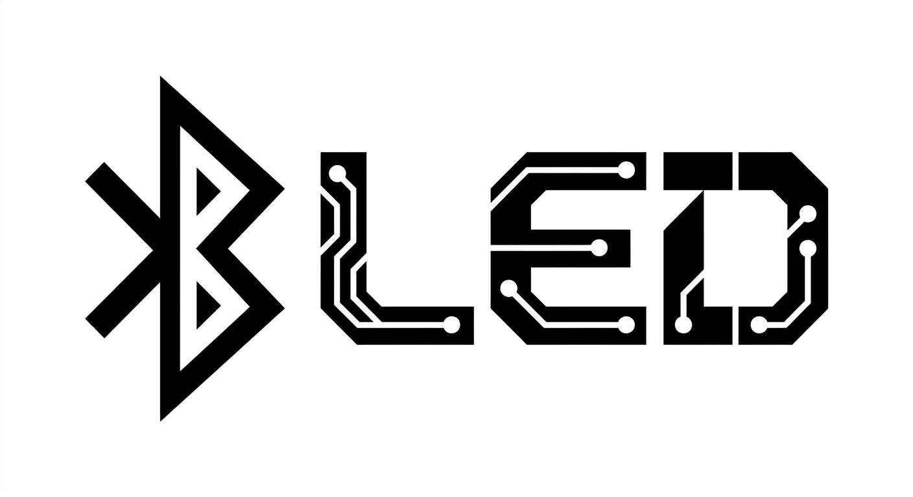

  

<h1 align="center">BLED</h1>

  Versatile control board for WS2812 compatible LED fixtures.
  Using WebAssembly for effects and Bluetooth Low Energy for control.

---

**BLED is a work in progress.** Although mostly feature complete, specifics of the effect API are subject to change.
The web UI is likely to undergo significant changes, the current version is a mostly vibe coded prototype.

## Building effects

[`bled-effect`](lib/effect/README.md) is a helper library for building BLED effects in Rust and compiling them to WebAssembly. The [`effects`](effects) directory contains example effect crates.

## License

The project is licensed under the MIT License, see [`LICENSE.txt`](LICENSE.txt).
